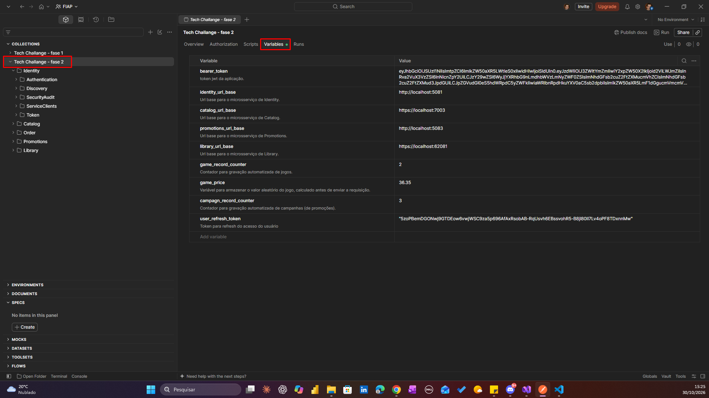
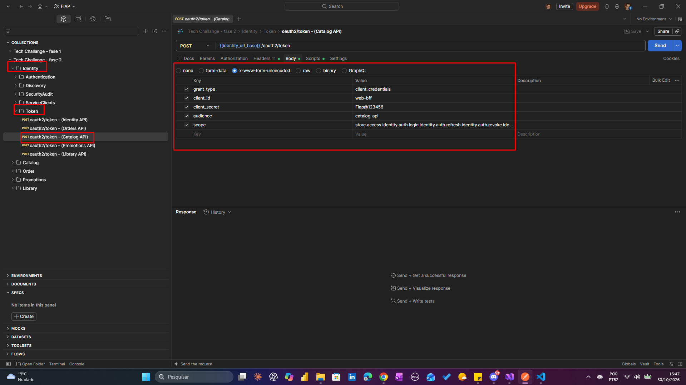
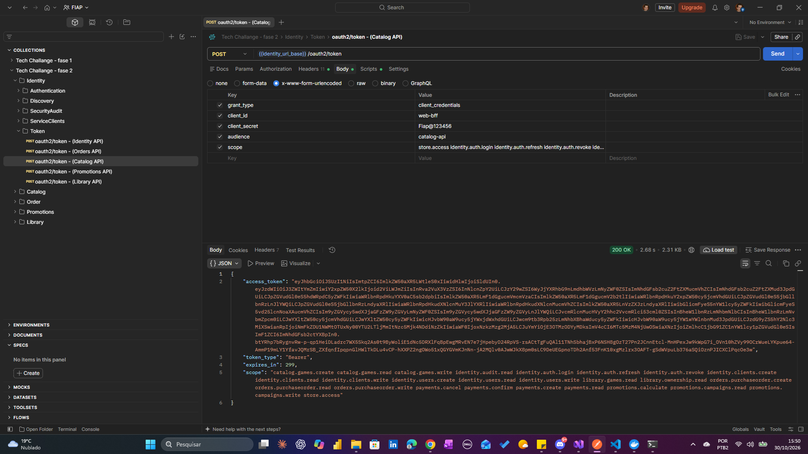
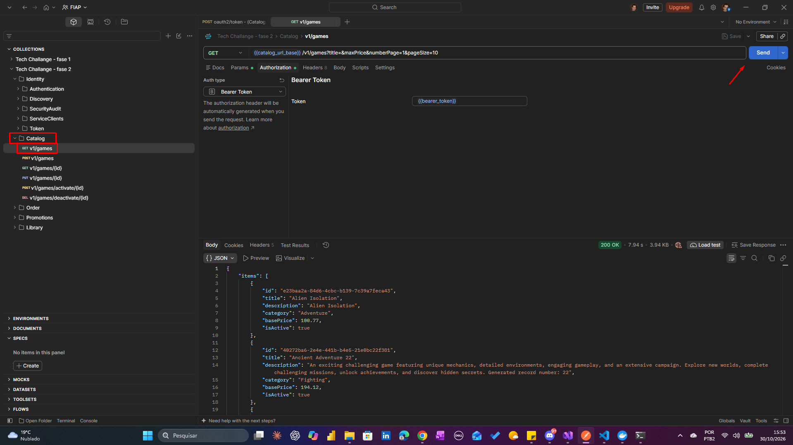

# Tech challange - Postman Collection

O arquivo `Tech Challange - fase 2.postman_collection.json` contém as coleções de requisições para o projeto do tech challange fase 2 da FIAP.
Através deste arquivo é possível fazer as simulações de requisições aos microsserviços.

## Como utilizar

Passos:

1 - O arquivo deve ser importado para a sua instalação de Postman; 
2 - Configurar as variáveis da aba `Variables` dentro da coleção `Tech Challange - fase 2`; 
3 - Após as API's estarem executando, basta fazer as chamadas.

## Variáveis que devem ser configuradas

Acesse as variáveis da coleção acessando a coleção `Tech Challange - fase 2` e depois a aba `Variables`. 
 

A coleção já vem com vários scripts (javascript) configurados para lidar com valores dinâmicos como tokens das API's e outros casos como preço de jogo, por exemplo.
Dependendo do contexto os scripts são configurados para executar antes ou depois de uma requisição ou após um response.
Desta forma, algumas variáveis não necessitam ser alteradas como:

`bearer_token` 
`game_record_counter` 
`game_price` 
`campagn_record_counter` 
`user_refresh_token` 

E as variáveis que precisam ser configuradas são justamente as que define o endereço base do microsserviço a ser utilizado:

`identity_url_base` 
`catalog_url_base` 
`promotions_url_base` 
`library_url_base`

OBS: para o fluxo de ordem de compra, todas devem ser configuradas com o endereço base.

## Qual request chamar primeiro

Quando o teste de request for feito para um determionado microsserviço, exemplo `Catalog`, acessar o endpoint `Token` e a request `oauth2/token - (Catalog API)` e efetuar o login do serviço, para depois acessar os endpoints do microsserviço `Catalog` e fazer a chamada dos request's.

**NOTA:** o login atualmente é configurado para expirar em 5 minutos.

Exemplo:

Acessando o endpoint Token:

Após o Send

**OBS**: não é necessário copiar o Token gerado para o outro endpoint, pois já está tudo configurado em qualquer action que exija autenticação.
 Para executar então basta simplesmente dentro do prazo de 5 minutos, executar uma action de um endpoint de Catalog.

